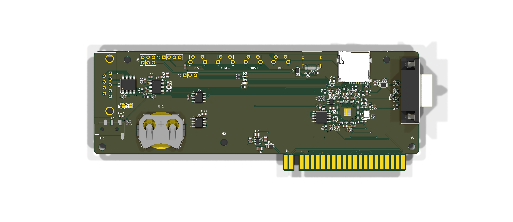
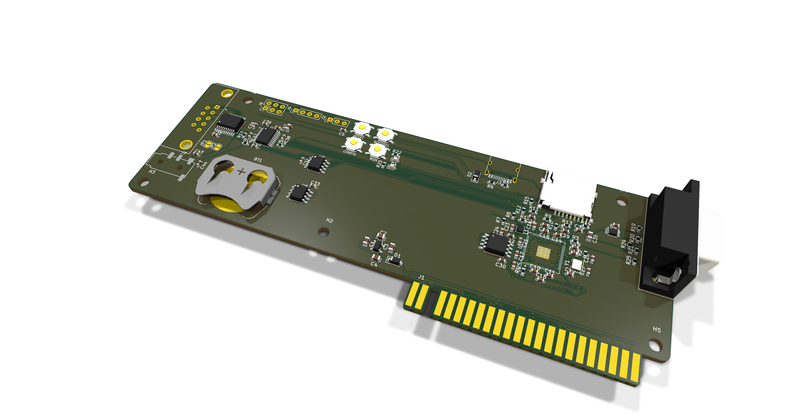

# OpenSpand Card

A chip-down, surface-mount [OpenSpand](https://codeberg.org/NollKollTroll/OpenSpand), the
open-source all-in-one expansion for the Sinclair ZX81, on a card that stands upright in
an edge socket on a ZX81 expansion bus. It's designed for JLCPCB assembly.





The card is 155 × 57 mm, close to the ZX81's width, so a row of cards fits a 3D-printed
case behind the computer. The ZX81's own 23-position edge (key slot at position 3) is cut
along the bottom as gold fingers, 6.38 mm in from the right edge so they line up with the
ZX81's connector. All the SMD parts are on the component side, which faces the ZX81.

| Edge | Connectors |
| --- | --- |
| Left | DE-9 joystick, 3.5 mm line out below it |
| Right | VGA (HD-15) |
| Top | SPI and UART headers; RESET, CONFIG, BOOTSEL and RUN buttons (right-angle, hand-fitted, pushed from above); USB-C; microSD |
| Bottom | ZX81 fingers |

**Status: unverified prototype (rev 0.1), fully routed.** ERC is clean, the PCB matches the
schematic, and DRC shows no clearance, edge or unconnected errors (only silkscreen
warnings). No board has been built, the firmware patch hasn't been compiled, and the VGA
output has no firmware yet. Review it before you order.

The full write-up (form factor, finger convention, routing results, regenerating) is in
[card/README.md](card/README.md).

## From modules to chips

Upstream V1.31 is built from plug-in modules plus through-hole parts. The card puts the
chips themselves on a 4-layer board:

| Function | Upstream V1.31 | OpenSpand Card |
| --- | --- | --- |
| MCU | Olimex Pico2-XL module | RP2350B + W25Q128JV 16 MB flash + Abracon ABM8-272-T3 12 MHz crystal |
| 3.3 V | regulator on module | ME6211C33 LDO |
| 1.2 V core | RP2350 switcher + inductor on module | ME6211C12 LDO (no inductor) |
| USB | on module | USB-C, BOOTSEL and RUN buttons |
| RTC | DS1307 module | DS3231MZ (built-in resonator, no crystal) + CR2032 |
| Settings EEPROM (0x50) | AT24C32 on RTC module | FT24C32A |
| I/O expander (0x27) | MCP23009 DIP-18 | MCP23009 SSOP-20 (same chip: 5 V-tolerant open-drain joystick inputs) |
| Audio | UDA1334 module | PCM5102A + 3.5 mm line-out jack |
| Composite video | pin header | VGA socket, 60 Hz (firmware not written yet) |
| SD card | full-size SD | microSD (TF-01A push-push) |
| 5 V joystick jumpers | pin-header jumpers | solder jumpers JP1, JP2 (open by default) |
| Serial port | UART header | UART header J10 (same pins as SMD2) |

The DS3231MZ answers at the DS1307's address (0x68) with the same time and date
registers, so the firmware's clock code runs unchanged. It shares the I2C bus and pull-ups
with the EEPROM and I/O expander. The CR2032 is only a backup cell; nothing charges it.

## Firmware

The card needs the upstream OpenSpand_SW 0.51.0 firmware with
[card/firmware/card-pins.patch](card/firmware/card-pins.patch) applied. The fingers are on
the same side as the RP2350B, so the card puts the Z80 bus on different GPIOs from
upstream:

| GPIO | Card |
| --- | --- |
| 0–7 | D0–D7 |
| 8–23 | A0–A15 |
| 24–31 | HALT, MREQ, IORQ, RD, WR, RESET, M1, RFSH |
| 32–47 | Z80 clock, I2S, VGA, green LED, UART, I2C, microSD |

Data still reads as the low byte of the GPIO register, as upstream does; only the address
read gains a shift. GPIO40–47 are the RP2350B's ADC pins, which aren't 5 V tolerant. On the
card they carry only 3.3 V signals (UART, I2C, microSD), so no 5 V bus line lands on them.

The PCM5102A gets 16-bit I2S at about 47.8 kHz, so BCK = 32 × fs, which it supports in its
PLL mode (SCK grounded). Like the pin map, this hasn't been tested on hardware.

## Ordering from JLCPCB

- **PCB**: upload `card/hardware/fab/OpenSpand-Card-gerbers.zip`. Choose 4 layers, 1.6 mm,
  any colour, and **gold fingers with a 45° bevel**. The tongue has no vias or pour and the
  inner planes stop at the body, so the bevel only cuts the fingers' ends.
- **Assembly**: top side. Upload `BOM-JLCPCB.csv` and `CPL-JLCPCB.csv`, then check every
  part's rotation in JLC's preview, especially U2, U3, U4, U7, U8, U9, J3, J5 and J7.
- **Hand-fit** (`hand-solder.csv`): the DE-9 (J4), the VGA socket (J8, BOOMELE VGA-002,
  LCSC C138387), the four buttons (SW1–SW4, C&K PTS645VL83-2 LFS) and the optional pin headers.

### Before ordering, check

- **Finger alignment**: the 6.38 mm offset assumes the ZX81's board is centred in its case.
  Measure from the case's right side to the end of the edge connector, subtract 6 mm, set
  `RIGHT_OVERHANG` in `card/tools/gen_pcb.py` and regenerate.
- **Backplane spacing**: the DE-9 and VGA socket stand about 12.5 mm off the board, so sockets on
  the bus need roughly 15 mm or more between them.
- **RP2350 support circuit**: the crystal (ABM8-272-T3, 15 pF load caps, 1 kΩ series
  resistor) follows Raspberry Pi's *Hardware design with RP2350*. The core supply doesn't: the
  on-chip switching regulator is unused (no inductor, VREG_LX open, VREG_FB grounded) and an
  ME6211C12 LDO (U9) feeds DVDD at 1.2 V, as in section 6.3.7 of the RP2350 datasheet. JLC
  may show its generic warning about following Raspberry Pi's guide.
- **Jack pinout**: J7 uses KiCad's PJ320D footprint (T = left, R1 = right, R2 and S = ground)
  against LCSC C431535. Compare with the LCSC drawing.
- **VGA footprint**: J8 uses KiCad's right-angle HD-15 footprint (2.29 x 1.90 mm pin
  pitch, 25 mm mounting holes). Compare it with the VGA-002 drawing on LCSC.
- **Coin cell**: fit a CR2032 in BT1 after assembly; the board ships without one.
- **Buttons**: SW1–SW4 are C&K PTS645VL83-2 LFS right-angle through-hole switches, marked
  DNP so JLC skips them; buy them from Digi-Key or Mouser (LCSC has only the short-plunger
  PTS645VK39) and solder them yourself.
- **Low-stock parts**: MCP23009T-E/SS (C629436) and FT24C32A (C232883) had a few hundred in
  stock when this was designed.

## Bus board

[ZX81 Bus](bus/README.md) is a passive three-slot backplane for the card: it plugs onto the
ZX81 in the same plane through a card-edge socket straddling its front edge, holds three cards in vertical card-edge sockets, and
repeats the ZX81's edge as gold fingers on its rear edge for a RAM pack or another bus. A 9 V DC jack powers the ZX81 and the bus from a modern supply.

## Earlier board

[OpenSpand SMD2](smd2/README.md) is the same circuit on a 100 × 70 mm board that plugs
straight onto the ZX81's edge connector with a socket, like upstream. The card is based on
it, and it's kept for reference. (The first board, OpenSpand SMD, kept upstream's GPIO map,
which puts A8–A15 on the RP2350B's ADC pins, which aren't 5 V tolerant. It has been
retired; it's in the git history.)

## Repository layout

```
card/                 OpenSpand Card (the main design)
  tools/              design.py is the single source of truth; the other scripts generate
                      the library, schematic, placement, routing and fab files from it
  hardware/           KiCad project, fab/ output
  firmware/           pin-map patch for OpenSpand_SW
  docs/               renders
smd2/                 OpenSpand SMD2, same structure
bus/                  ZX81 Bus, three-slot backplane, same structure
```

The schematics and PCBs are generated: edit `design.py` and regenerate, as described in
[card/README.md](card/README.md#regenerating).

## License

Hardware: CC BY-SA 4.0, as a derivative of OpenSpand HW 1.3.1 by Adam Klotblixt & ZX-Team.
The DE-9 footprint (and SMD2's edge-socket footprint) are copied unchanged from upstream.
The OpenSpand firmware is GPL-3.0 and lives upstream; the firmware patches here are GPL-3.0.
