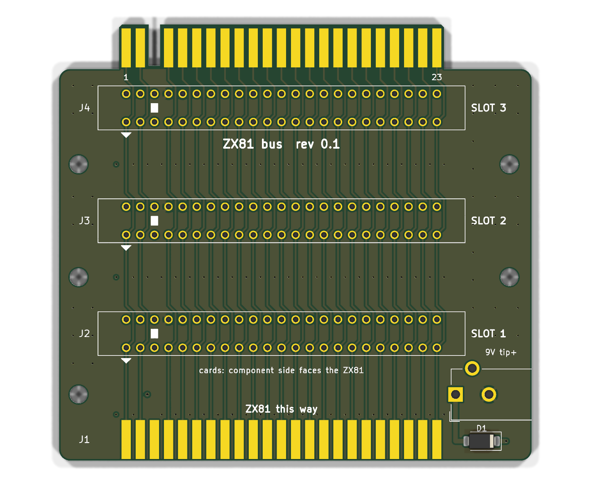

# ZX81 Bus

A passive three-slot backplane for the ZX81. It plugs onto the ZX81's edge connector in
the same plane as the ZX81's board, holds three cards such as the [OpenSpand Card](../card/README.md) upright in card-edge
sockets, and repeats the ZX81's edge as gold fingers on its rear edge, so a RAM pack, a
printer interface or another bus board can plug on behind it. A 9 V DC jack on the right
lets a modern power supply run the ZX81 and the bus.



**Status: unverified prototype (rev 0.1).** ERC is clean, the PCB matches the schematic,
and DRC reports only two silkscreen warnings: the DC jack's outline runs past the right
edge, where the jack overhangs on purpose. No board has been built.

## Layout

```
          ┌─┐ rear fingers: a copy of the ZX81 edge (C row on top)
   ┌──────┘ └──────┐
   │ ▭▭▭ SLOT 3 J4 │
   │ ▭▭▭ SLOT 2 J3 │   cards stand here, component side toward the ZX81
   │ ▭▭▭ SLOT 1 J2 │
   │          J6 ◧═│   9 V DC jack, opening to the right
   │ ▮▮▮ J1 ▮▮▮    │   pads for the socket that straddles the front edge
   └───[socket]────┘
          ZX81       same plane as the bus board
   seen from above, standing in front of the ZX81
```

- **Board**: 85 x 78.5 mm: an 85 x 70.5 mm body plus the 8 mm rear tongue. Four layers:
  F.Cu and B.Cu carry the bus, In1 is a solid GND plane and In2 a +5V plane. The body
  runs from 7 mm left of the slots (room for the holes) to 12 mm right of them (room for
  the DC jack); `X0` and `XR` in `tools/gen_pcb.py` set the sides.
- **J1** is a row of pads on each side of the front edge for a straddle-mounted socket:
  take a 2 x 23, 0.1 in card-edge socket, bend its tails in (about 30°) so they pinch the
  board, and solder them to the pads. The socket sticks out of the front edge and takes
  the ZX81's fingers, so the bus board lies in the same plane as the ZX81's board. The
  pads are 1.65 x 7 mm, the same as the rear fingers, starting 0.3 mm in from the edge
  (JLC's minimum copper-to-edge clearance): the top row (C) on F.Cu, the
  bottom row (A) on B.Cu. Position 3 (the key) has pads with no net, for soldering a tail
  there for strength if the socket has one. The front edge is straight; only the rear
  edge has a tongue.
- **J2-J4** are vertical card-edge sockets: 2 x 23 positions at 0.1 in (the same centres as
  the fingers), rows 0.2 in apart, key at position 3. Position 3 has plated holes with no
  net, so a socket with all 46 tails fits, keyed or not. Holes are 1.0 mm on 1.5 mm pads.
- **Slot pitch** is 0.8 in (20.32 mm). The card's DE-9 and VGA socket stand about 12.5 mm
  off its component side, and the card's README asks for at least 15 mm. `SLOT_PITCH` in
  `tools/gen_pcb.py` sets it.
- **J5**, the rear fingers, match the card's: 1.65 x 7 mm on an 8 mm tongue, key slot at
  position 3, no vias or pour on the tongue, and the inner planes stop at the body.
- **J6**, a 5.5/2.1 mm DC jack, tip positive, on the ZX81's +9V line. It sits in the
  front-right corner between J1 and slot 1, with its opening 0.5 mm past the right edge so
  an enclosure wall can sit flush with it. Its footprint is KiCad's CUI PJ-102AH (round
  holes: centre pin at the back, sleeve, and the switch pin, left unconnected).
- **D1**, an SS34 Schottky (3 A, 40 V, SMA, LCSC C8678), in series from the jack's centre
  pin to +9V, in front of the jack. A centre-negative supply is blocked instead of putting
  -9 V on the ZX81. It drops about 0.4 V, which the ZX81's 7805 doesn't mind at 9 V.
  From D1's cathode, the +9V run is at the far left (position 2), and the bus runs cover
  both outer layers, so the feed crosses on In2 as a 1 mm track cut into the +5V plane,
  just behind J1's pads, and comes up through a via beside the +9V run.
- **Five M3 holes** (3.2 mm) for an enclosure: three down the left edge (between the slots
  and beside the jack) and two down the right edge, between the slots.

## Which way round

Every connector has position 1 on the left (seen from above, standing in front of the
ZX81), and position *n* of every connector sits at the same x, so each signal is one
straight run from front to back:

- **C row** (the ZX81's top side: D7, ~RAMCS, key, D0 ... ~RFSH) on F.Cu. The
  straddle socket's top contacts touch the ZX81's top side and its top tails solder to
  the top pads. On each slot it is the front row, nearer the ZX81, so a card's component
  side faces the ZX81, as the card is designed. On the rear tongue it is on the top, as
  on the ZX81.
- **A row** (the underside: +5V, +9V, key, 0V ... ~ROMCS) on B.Cu: the slots' rear row and
  the bottom of the rear tongue.

Where a run meets the other row's hole at a slot, it steps half a pitch sideways and
back. At J1 there are no holes, so the runs start straight from the pads. No autorouter
is needed; `gen_pcb.py` draws every track. Signals are 0.3 mm,
+5V, +9V and GND 0.6 mm, with 0.2 mm clearance. +5V also feeds the In2 plane through
vias between the connectors.

## Check before ordering

- **Which end is position 1.** Everything rests on the card's statement that, seen from
  above with the ZX81 in front of you, the ZX81's key slot is near the left end of its
  edge. Check it on the machine. If the key is at the right end, every connector here must
  be mirrored before the board is safe to plug in: +5V and +9V would land on the wrong pins.
- **J1's socket.** Fit it with its key at position 3, the third pad from the left. The
  solder joints carry the insertion force, so a bead of epoxy along the socket body and
  the board edge is worth adding. The socket's mating slot should line up with the board's
  mid-plane so the bus sits level with the ZX81's board; bend the tails evenly.
- **Slot socket.** The footprint assumes straight dip-solder tails on 0.2 in rows and a
  body about 66 x 7.9 mm. Check the socket you buy, especially the row spacing; many
  0.1 in card-edge sockets use 0.14 or 0.15 in instead.
- **Height.** A card's body starts at the top of its socket. J1's socket and the ZX81
  case sit in front of slot 1; the first card's components reach about 13 mm toward
  them at that height, so check the clearance in the case. Slot 1 is 22.86 mm from the
  front edge (`YF` in `gen_pcb.py`).
- **Current.** All three cards share the ZX81's +5V through a 0.6 mm run on B.Cu
  plus the In2 plane, and +9V through a 0.6 mm run. That is fine for the OpenSpand Card,
  which draws well under 0.5 A.
- **One supply at a time.** The DC jack connects straight to the ZX81's +9V pin, so it
  backfeeds the ZX81's own power input. Don't plug in the ZX81's original supply as well.
  D1 blocks a centre-negative supply, but only on the jack. Most of the ZX81's power goes through its own 7805, so check that it stays cool
  with the cards fitted.
- **DC jack part.** The footprint is the PJ-102AH layout. Check your jack's pins against
  it, and that it is 5.5/2.1 mm (some similar jacks are 2.0 or 2.5 mm).

## Ordering

Upload `hardware/fab/ZX81-Bus-gerbers.zip` to JLCPCB: 4 layers, 1.6 mm, and **gold fingers
with a 45° bevel** for the rear edge only. Ask for the front edge to be left square: J1's
socket is soldered to those pads. Everything is hand-soldered (`hand-solder.csv`): the
four 2 x 23 card-edge sockets (J1 straddling the front edge, J2-J4 in the slots), the
DC jack (J6) and D1 (an SMA part; its stripe, the cathode, faces the right edge).

## Regenerating

From `tools/`:

```bash
python3 gen_lib.py      # project library: slot socket, front straddle pads, rear fingers
python3 gen_sch.py
KPY=/Applications/KiCad/KiCad.app/Contents/Frameworks/Python.framework/Versions/Current/bin/python3
$KPY gen_pcb.py         # placement, every track, vias and pours
python3 export_fab.py
```

Edit `design.py` (connectivity) or the constants at the top of `gen_pcb.py` (slot pitch,
board size), and regenerate. `export_fab.py` refills the zones before it exports.

## License

CC BY-SA 4.0, like the OpenSpand Card it carries.
