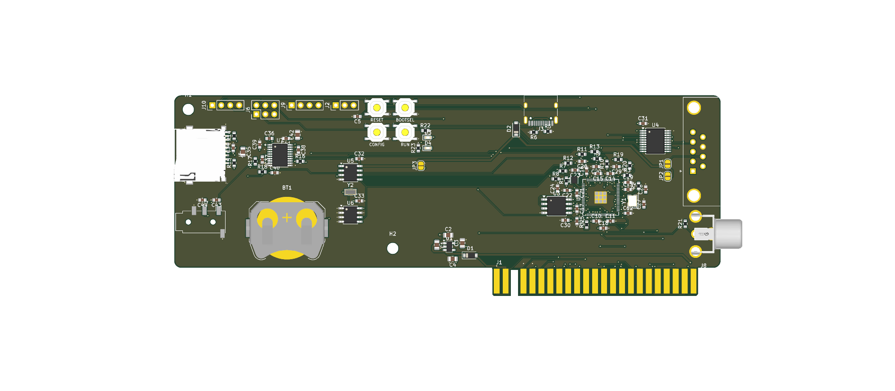
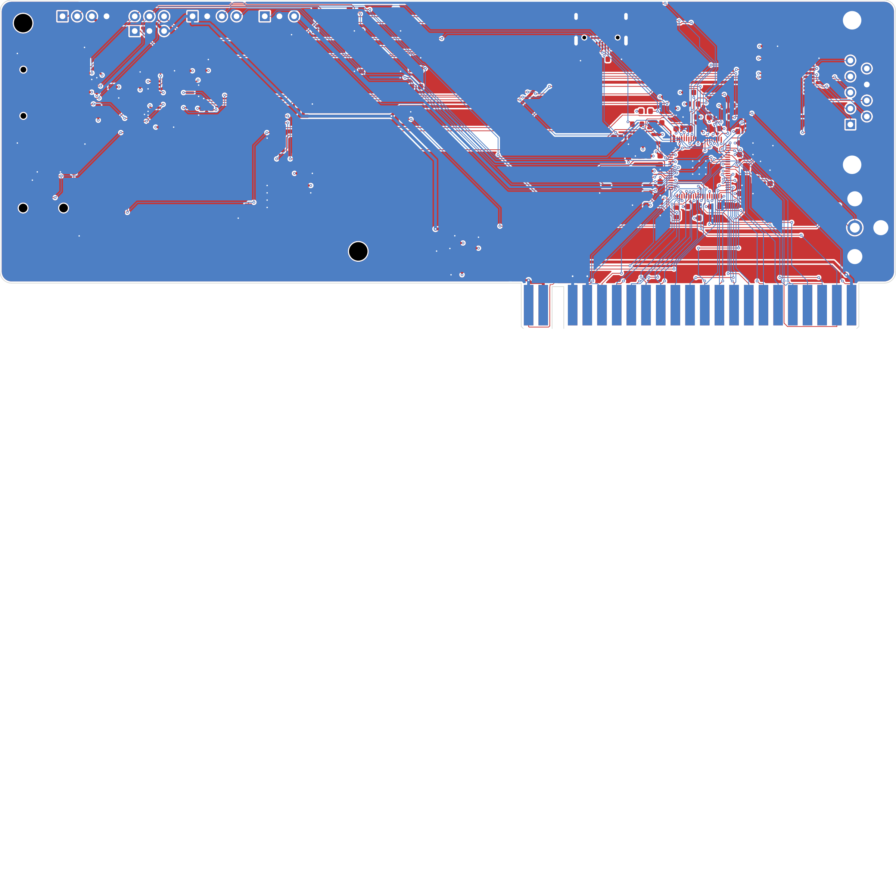

# OpenSpand Card

The [SMD2](../smd2/README.md) circuit on a card that stands upright in an edge socket on a
ZX81 expansion bus. The card is 155 mm wide, close to the ZX81's 167 mm, so it can go in a
3D-printed case. It is 57 mm tall: a 49 mm body, plus the fingers.

**Status: unverified prototype (rev 0.1).** No board has been built, and the firmware patch
hasn't been compiled or tested. See [Result](#result) for the routing and check state.



## Form factor

```
 ┌──────────────────────────────────────────────────────────────────────┐
 │ UART SPI DIG SWD  buttons             USB-C                   ┌─────┤
 │◄microSD  DAC                                           RP2350B│DE-9►│
 │                                                               └─────┤
 │◄line out    ▼CR2032                                             RCA►│
 └──────────────────────────────┐▌▌ ▌▌▌▌▌▌▌▌▌▌▌▌▌▌▌▌▌▌▌▌┌─────┘
                                └─────────────────────────┘
   seen from the front (the component side, which faces the ZX81)
```

- **Fingers**: the ZX81's own edge, 23 positions at 0.1 in, key slot at position 3
  (2 fingers left of the slot, 20 right of it). Fingers are 1.65 x 7 mm on an 8 mm tongue.
- **Which side is which**: the components face the ZX81. Seen from that side the card
  matches the ZX81's edge seen from above: the front fingers carry the ZX81's top-side
  signals (D7, ~RAMCS, key, D0 ... ~RFSH), and the back fingers carry its underside
  signals (+5V, +9V, key, 0V ... ~ROMCS). Position 1 is on the left. A backplane that
  wires each socket straight through to the ZX81 connector, ZX81 top row to the socket's
  front row, works as-is.
- **Alignment**: the fingers sit 6.38 mm in from the card's right edge. That figure
  assumes the ZX81 board sits centred in its 167 mm case: the board is 142.24 mm wide
  (from the [ZX81+38](https://github.com/mahjongg2/ZX81plus38) drop-in replacement), and
  its edge connector runs to the board's right end. **Measure a real ZX81 before ordering**:
  take the distance from the case's right side (seen from the front) to the end of the
  edge connector, and subtract 6 mm. Set `RIGHT_OVERHANG` in `tools/gen_pcb.py` to the
  result and rerun the pipeline.
- **Connectors**: on the right edge, the DE-9 with the RCA jack for composite video below
  it. On the left edge, the microSD with the line-out jack below it; the audio DAC sits
  between them, just inboard. On the bottom edge, left of the fingers: the clock's coin
  cell, whose holder opens toward the edge so the cell slides straight out. Along the top
  edge: USB-C, the pin headers and four buttons, each named on the silkscreen: RESET and
  CONFIG, as on OpenSpand, plus BOOTSEL and RUN for the RP2350B (upstream has BOOTSEL on
  its Pico module and RUN only as a pin).
  The DE-9 and RCA stand about 12.5 mm off the board, so sockets on the backplane need
  roughly 15 mm or more between them.
- **Clock battery**: a plain CR2032 in a Keystone 3034 holder, wired straight to the
  DS1307's VBAT pin. There is no charging circuit, so it takes ordinary, non-rechargeable
  cells. (Plug-in DS1307 modules such as the common Tiny RTC often trickle-charge an
  LIR2032 and need that rechargeable cell; SMD replaced the module with the bare chip.)
- **Two M3 holes** for a case.

## What changed from SMD2

| | SMD2 | Card |
| --- | --- | --- |
| Board | 100 x 70 mm, socket on the bottom edge | 155 x 57 mm card with gold fingers |
| ZX81 connection | edge socket (plugs onto the ZX81) | fingers (stand in a socket on a bus) |
| Composite video | 2-pin header J8 | RCA jack J8 (CUI RCJ-014, LCSC C4991844, hand-fitted) |
| DE-9 | bottom side | top side, right edge |
| GPIO0..7 | control lines | D0..D7 |
| GPIO24..31 | D0..D7 | control lines |

GPIO8..23 (A0..A15) and GPIO32..47 (clock, I2S, video, LEDs, UART, I2C, microSD) are the
same as SMD2.

**Why the bus groups swap.** On SMD2 the edge socket is on the bottom of the board. Here
the fingers are on the same side as the RP2350B, which mirrors the left-to-right order. With
U2 turned 90° the bus pins sweep round its lower-left corner and along its bottom edge
toward the fingers: data first (their fingers are on the left), then the address bus,
then the control lines up its right side (their fingers are on the right).

## Result

Fully routed on four layers (signal, GND, power, signal). DRC with schematic parity and a
zone refill reports no copper, clearance, edge or unconnected errors; what remains is
silkscreen only (reference text over copper, overlapping or near the edge), which the fab
clips. ERC is clean.

| | Card | SMD2 |
| --- | --- | --- |
| Vias | 298 | 268 |
| Signal vias | 153 | 126 |
| Track length | 4193 mm | 3520 mm |
| Z80 bus track | 1118 mm | 1319 mm |

The Z80 bus is shorter than on SMD2 because the fingers run right under U2. Most of the
extra track is the long runs across the card to the microSD, line out and pin headers at the
left end. The run is clean: Freerouting closed every connection, and no signal runs on the
inner planes. The only inner-layer copper is the +1V1 core rail, a short spur on In2 as on
SMD2.



## Firmware

`firmware/card-pins.patch` applies to upstream OpenSpand_SW 0.51.0, like SMD2's patch:

```bash
cd OpenSpand/OpenSpand_SW
patch -p1 < /path/to/card/firmware/card-pins.patch
```

It is SMD2's patch with the data bus moved back to GPIO0..7, so data reads and writes
use the low byte of the GPIO registers exactly as upstream does, with no shift. Only the
address read gains a shift (`gpio_get_all_lo() >> 8`). The video PIO changes (GPIO base
16, `wait gpio 16` for Z80_CLK on GPIO32) are the same as SMD2's. SMD2's
[checklist](../smd2/README.md#firmware) applies: timing, I2S above pin 31, and SDK pin
handling with a GPIO base.

## Regenerating

From `tools/`:

```bash
python3 gen_lib.py      # project library: edge fingers, RCA jack (and the SMD2 parts)
python3 gen_sch.py
KPY=/Applications/KiCad/KiCad.app/Contents/Frameworks/Python.framework/Versions/Current/bin/python3
$KPY gen_pcb.py
FREEROUTING_JAR=~/freerouting.jar JAVA=/opt/homebrew/opt/openjdk/bin/java $KPY route.py 150
$KPY finish.py
python3 export_fab.py
```

## Ordering

Fab files go to `hardware/fab/`: `OpenSpand-Card-gerbers.zip`, `BOM-JLCPCB.csv`,
`CPL-JLCPCB.csv` and `hand-solder.csv`. Ordering is as in the
[main README](../README.md#ordering-from-jlcpcb), plus:

- **Gold fingers**: choose "Gold fingers: Yes" and a 45° bevel. JLCPCB's gold-finger option
  plates the fingers with hard gold, which wears far better than ENIG in a socket.
- The tongue has no vias and no copper pour, and the inner planes stop at the body, so the
  bevel cuts nothing but the fingers' ends.
- Hand-fit: DE-9 (J4), RCA jack (J8) and the optional pin headers.

## License

Hardware: CC BY-SA 4.0, as a derivative of OpenSpand HW 1.3.1 by Adam Klotblixt & ZX-Team.
The firmware patch modifies GPL-3.0 code from OpenSpand_SW and is GPL-3.0.
