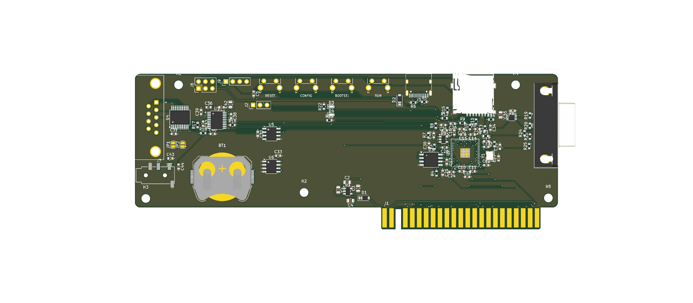
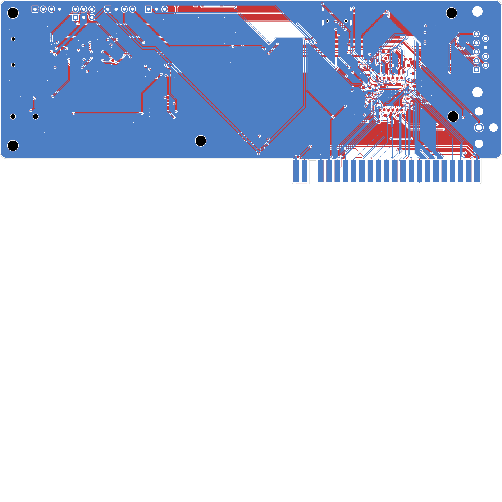

# OpenSpand Card

The circuit of the retired [SMD2](https://github.com/timex-sinclair-projects/openspand-smd/tree/46fc425/smd2) board on a card that stands upright in an edge socket on a
ZX81 expansion bus. The card is 155 mm wide, close to the ZX81's 167 mm, so it can go in a
3D-printed case. It is 57 mm tall: a 49 mm body, plus the fingers.

**Status: unverified prototype (rev 0.2).** Rev 0.2 cards have been built, but there
are no test results yet for the board or the firmware patch, which is for v0.2 only.
Rev 0.2 swaps rev 0.1's VGA socket for DVI on an HDMI socket
([issue 7](https://github.com/timex-sinclair-projects/openspand-smd/issues/7)), and the DVI
output has no firmware yet: see [Firmware](#firmware). See [Result](#result) for the routing and
check state.



## Form factor

```
 ┌──────────────────────────────────────────────────────────────────────┐
 │ SPI        ▲R   ▲G     ▲RESET ▲CONFIG ▲BOOT ▲RUN  USB-C       ┌──────┤
 ├─────┐ U4                                                      │ SD  ►│
 │◄DE-9│                                                         ├──────┤
 ├─────┘                                         RP2350B         │HDMI ►│
 │                                                               └──────┤
 └──────────────────────────────┐▌▌ ▌▌▌▌▌▌▌▌▌▌▌▌▌▌▌▌▌▌▌▌┌─────┘
                                └─────────────────────────┘
   seen from the front (the component side, which faces the ZX81)
```

- **Fingers**: the ZX81's own edge, 23 positions at 0.1 in, key slot at position 3
  (2 fingers left of the slot, 20 right of it). Fingers are 1.65 x 7 mm on an 8 mm tongue.
- **Which side is which**: the components face the ZX81. Seen from that side the card
  matches the ZX81's edge seen from above: the front fingers carry the ZX81's top-side
  signals (D7, ~RAMCS, key, D0 ... ~RFSH), and the back fingers carry its underside
  signals (+5V, +9V, key, 0V ... ~ROMCS). Position 1 is on the left. A backplane that
  wires each socket straight through to the ZX81 connector, ZX81 top row to the socket's
  front row, works as-is.
- **Alignment**: the fingers sit 6.38 mm in from the card's right edge. That figure
  assumes the ZX81 board sits centred in its 167 mm case: the board is 142.24 mm wide
  (from the [ZX81+38](https://github.com/mahjongg2/ZX81plus38) drop-in replacement), and
  its edge connector runs to the board's right end. **Measure a real ZX81 before ordering**:
  take the distance from the case's right side (seen from the front) to the end of the
  edge connector, and subtract 6 mm. Set `RIGHT_OVERHANG` in `tools/gen_pcb.py` to the
  result and rerun the pipeline.
- **Connectors**: on the left edge, the SPI header (J6) at the top and the DE-9 joystick port
  below it, with the joystick's I/O expander (U4) just inboard. On the right edge, the microSD
  (the card goes in from the side) above the HDMI socket. Along the top edge: the two status
  LEDs, four buttons and USB-C. There's no SWD header; flash over USB with BOOTSEL.
  The buttons are named on the silkscreen: RESET and CONFIG, as on OpenSpand, plus BOOTSEL
  and RUN for the RP2350B (upstream has BOOTSEL on its Pico module and RUN only as a pin).
  The DE-9 stands about 12.5 mm off the board (the HDMI socket about 6.5 mm), so sockets on
  the backplane need roughly 15 mm or more between them.
- **Buttons through the top of the case**: SW1–SW4 are C&K PTS645VL83-2 LFS right-angle
  through-hole tactile switches, hand-fitted (DNP for JLC). Each has a 3.5 mm plunger pointing
  up out of the top edge. For the case: the body's front is flush with the board edge, the
  plunger tip is about 5.8 mm past it, and the plunger's axis is 3.5 mm above the component
  side. The four sit at 49.5, 62.7, 75.9 and 89.1 mm from the card's left edge (RESET, CONFIG,
  BOOTSEL, RUN). The body is 7.5 mm wide.
- **Status LEDs through the top of the case**: D3 (red) and D4 (green) are 3 mm diffused
  through-hole LEDs (Kingbright WP710A10ID and WP710A10GD), hand-fitted (DNP for JLC). Bend
  the legs 90° about 1.3 mm from the flange so the body lies on the component side and looks
  up out of the top edge, like the buttons: the flange sits 0.7 mm inside the edge, the dome
  about 4.6 mm past it, and the LED's axis is 2 mm above the board. Their centres are 26 and
  36 mm from the card's left edge, 10 mm apart, with about 4 mm clear to H1 and 6 mm to
  RESET. The flat (cathode) side goes to the square pad. Each runs from 3.3 V through 2.2 kΩ
  (R22, R23), about 0.6 mA red and 0.5 mA green: a soft glow from a diffused LED, not a glare.
  For brighter, drop the resistors (not below 330 Ω); for dimmer, raise them.
- **1.2 V core LDO instead of the RP2350's switcher**: an ME6211C12 (U9) feeds DVDD, so there's
  no inductor and none of the switcher's layout rules. The RP2350 datasheet allows this
  (section 6.3.7): VREG_LX is left open, VREG_FB is grounded, and VREG_VIN and VREG_AVDD stay
  powered for the reset and brownout circuits. It's 1.2 V rather than 1.1 V because the
  firmware runs the core at 1.20 V for its 208 MHz overclock. The on-chip regulator still
  starts at power-up but can't drive anything without its inductor; firmware can turn it off
  (VREG.HIZ) to save about 400 µA. The LDO wastes about 0.1 W.
- **DVI on an HDMI socket instead of composite video**: the RP2350's HSTX block, which can
  only drive GPIO12..19, sends DVI (TMDS) to an HDMI type A socket (J8, Molex 208658-1001) on
  the right edge. Each of the eight lines goes through 220 Ω (R24–R31), as on Adafruit's DVI
  Sock and HSTX adapter, and then through a flow-through ESD array (U10, U11, TPD4E05U06) at
  the socket. Pin 18 gets +5V through a Schottky (D5), which some displays need before they'll
  take a picture. DDC, CEC and hot-plug detect are left open: DDC pulls up to 5 V and the free
  GPIOs aren't 5 V tolerant. HSTX can put any lane or the clock, of either polarity, on any of
  its pins, so the pairs are wired in the order the socket's pins come.
- **Sound over HDMI, no line-out or serial port**: HSTX needs eight GPIOs, and the Z80 bus
  needs every other 5 V-tolerant one, so the I2S DAC (and its line-out jack) and the UART
  header are gone; the firmware is to send sound as HDMI audio. The DE-9's I/O expander,
  the real-time clock and the settings EEPROM stay on I2C exactly as in rev 0.1.
- **Bus pins round HSTX**: only GPIO0..39 are 5 V tolerant, and with HSTX on GPIO12..19 the 32
  bus lines take every one of the rest. D0..D7 stay on GPIO0..7 and A0..A3 on GPIO8..11.
  A15..A4 are on GPIO20..31, in reverse, so their tracks fan out to the fingers without
  crossing, and the control lines are on GPIO32..39. Z80_CLK goes to GPIO40 (an ADC pin)
  through one gate of a 74LVC3G34 (U8), whose inputs take 5 V. The red LED (D3) is on the
  I/O expander's GP2 as in rev 0.1, and the green LED (D4) is on GPIO41.
- **Real-time clock**: a DS3231MZ (U5) at 0x68 in place of SMD2's DS1307. It has a
  built-in MEMS resonator, so there's no 32.768 kHz crystal, and it keeps time to about
  ±5 ppm (a few minutes a year). It uses the DS1307's address and time registers, so the
  firmware's `GET TIM` / `GET DAT` and time and date screens work unchanged. Backup is a
  plain CR2032 (BT1) that slides in from the bottom edge; there's no charger.
- **Five M3 holes** (3.2 mm, unplated) for screw posts in a case: top left, between the SPI
  header and the LEDs (H1); lower left corner (H3); top right corner, above the microSD (H4); bottom right, in
  the corner below the HDMI socket (H5); and one near the bottom middle (H2).

## What changed from SMD2

| | SMD2 | Card |
| --- | --- | --- |
| Board | 100 x 70 mm, socket on the bottom edge | 155 x 57 mm card with gold fingers |
| ZX81 connection | edge socket (plugs onto the ZX81) | fingers (stand in a socket on a bus) |
| Video | composite, 2-pin header J8 | DVI on an HDMI socket J8 (HSTX) |
| Audio | I2S DAC, line-out jack | over HDMI (firmware); no DAC or jack |
| DE-9 | bottom side | top side, left edge |
| Serial port (UART) | GPIO40-41, header J10 | none |
| Red LED | GPIO38 (PWM, also sampled audio) | I/O expander GP2 (on/off only) |
| Green LED | GPIO39 | GPIO41 |
| Headers | SWD, UART, SPI, digitized audio | SPI only |
| Real-time clock | DS1307 + 32.768 kHz crystal + CR2032 | DS3231MZ (no crystal) + CR2032 |
| RP2350 core supply | on-chip switcher + 3.3 µH inductor | ME6211C12 LDO at 1.2 V |
| Buttons | top-push SMD, inboard | right-angle THT on the top edge, hand-fitted |
| GPIO0..7 | control lines | D0..D7 |
| GPIO8..11 | A0..A3 | same |
| GPIO12..19 | A4..A11 | HSTX (DVI) |
| GPIO20..31 | A12..A15, D0..D7 | A15..A4 |
| GPIO32..39 | Z80 clock, I2S, video, LEDs | control lines |
| GPIO40..47 | UART, I2C, microSD | Z80 clock (buffered), green LED, I2C, microSD |

**Why the bus moves.** On SMD2 the edge socket is on the bottom of the board. Here the
fingers are on the same side as the RP2350B, which mirrors the left-to-right order. With
U2 turned 90° its GPIO0..31 sweep round its lower-left corner, along its bottom edge toward
the fingers and up its right side. HSTX sits in the middle of that bottom edge (GPIO12..19),
so the bus goes round it: data and A0..A3 to its left, the rest of the address bus up U2's
right side, and the control lines along its top edge. The DVI pairs leave U2's bottom edge
and run right to the HDMI socket, under the address lines, which reach the fingers on
B.Cu.

## Result

Fully routed on four layers (signal, GND, power, signal). DRC with schematic parity and a
zone refill reports no copper, clearance, edge or unconnected errors; what remains is
silkscreen only (reference text over copper, overlapping or near the edge), which the fab
clips. ERC is clean.

| | Card rev 0.2 | Card rev 0.1 | SMD2 |
| --- | --- | --- | --- |
| Vias | 250 | 301 | 268 |
| Signal vias | 118 | 150 | 126 |
| Track length | 3367 mm | 3545 mm | 3520 mm |
| Z80 bus track | 1174 mm | 1095 mm | 1319 mm |

The Z80 bus is shorter than on SMD2 because the fingers run right under U2. Rev 0.2 has less
track and fewer vias than rev 0.1 because the audio DAC, line out and UART header at the
left end are gone. The eight TMDS lines are 23 to 26 mm long with no vias; the two halves of
each pair are within 0.5 mm of each other. Freerouting closed every connection (the first
run left RUN open, and a second run with 200 passes closed it), and no signal runs on the
inner planes. The only inner-layer copper is the +1V2 core rail, a short spur on In2 as on
SMD2. The silkscreen warnings went up from rev 0.1 (mostly references overlapping in the
column of 0402 resistors). The fab clips silkscreen off exposed copper.



## Firmware

`firmware/card-pins.patch` applies to upstream OpenSpand_SW 0.51.4 (commit c50be4b):

```bash
cd OpenSpand/OpenSpand_SW
patch -p1 < /path/to/card/firmware/card-pins.patch
```

It puts OpenSpand on the card's pins and sends the ZX81's picture out of the HDMI socket
as 640 x 480 DVI at 60 Hz. The ZX81's own video output should still work too, as the ULA
makes that picture from the bytes the card puts on the bus. It builds with arduino-pico.
On a TS1000 it boots to the K cursor: from a cold start, after the TS1000 is power-cycled
with USB connected, and from the reset button (2026-11-23). The DVI picture shows the
boot screen centred, in full white (2026-11-23). Nothing else has been tested yet.

- **Bus**: pins as in `firmware/pins.h`. Data is still the low byte of the GPIO registers.
  The control lines, on GPIO32..39, are read from the high input register. The address is
  `((lo >> 8) & 0x000F) | ((rbit(lo) << 4) & 0xFFF0)` on one read of the low register:
  A0..A3 sit on GPIO8..11 and A4..A15 on GPIO31..20, reversed. Timing is untested.
- **Video PIO**: GPIO base 16, with `.define Z80_CLK 40`. Pioasm stores that as 8 and
  `pio_add_program()` turns it into index 24 of the window. Don't write 24 in the source:
  the loader would turn it into GPIO24, which is A11. After editing the `.pio` file,
  regenerate the header with pioasm.
- **Raster and line counter** still run, without output pins, because they pick the row of
  each character that goes to the ULA. Pixel output goes to DVI instead (below).
- **Core voltage**: the `vreg_set_voltage()` call is gone, as an LDO supplies 1.2 V.
- **ZX81 power watch**: with USB connected, the card keeps running while the ZX81 is off.
  As upstream does, the firmware drives RESET high after boot, so the ZX81's power-on reset
  can't work when it's switched back on. Resetting just the Z80 isn't enough either: on a
  TS1000 that left a blank or garbled screen. So `loop()` watches the buffered Z80 clock.
  After 20 ms without it, the card holds RESET low, and when the clock returns it restarts
  itself, as the RUN button does. The watch doesn't read RESET, because holding RESET low
  for 1.5 s or 5 s is a button command (remount the SD card, factory reset).
- **Red LED**: bit 2 of the I/O expander, on/off only, updated within about 5 ms. Raw
  joystick reads hide that bit. Sampled audio on the LEDs keeps the right channel only.
- **Serial**: UART1 has no pins, so serial output is discarded and a read can return a
  stray zero byte. The DVI build has no USB either, so `Serial` is a stub that discards
  everything. The `$` serial file server is off, as it would wait until the watchdog
  reset the card.
- **Sound**: the AY registers work, but nothing is rendered until there is HDMI audio.

Upstream's 0.51.4 release was built with arduino-pico 6.3.2 for "Olimex Pico2XL" at -O3.
Unpatched upstream built that way gives a UF2 the same size as the release (410,112
bytes). To build the card's version:

```bash
U=https://github.com/earlephilhower/arduino-pico/releases/download/global/package_rp2040_index.json
arduino-cli core install rp2040:rp2040@6.3.2 --additional-urls $U
arduino-cli compile -b rp2040:rp2040:olimex_pico2xl:opt=Optimize3,usbstack=nousb --output-dir out OpenSpand_SW
```

`usbstack=nousb` is required: DVI takes PLL_USB, so the USB stack must not start. With no
USB, the 1200-baud touch can't reach the boot loader. To reflash, hold BOOTSEL and tap
RUN, or hold CONFIG at power-up, then run `picotool load -v -x out/OpenSpand_SW.ino.uf2`
or copy the UF2 to the drive that appears.

The Olimex board's default pins are no problem here. Its UART, SPI, I2C and LED defaults
land on bus and HSTX lines, but the sketch never uses them:

- I2C goes to Wire1 on GPIO42/43 through `setSDA()` and `setSCL()`.
- The microSD gets SPI1 on GPIO44..47 through `pico_fatfs_set_config()`, which
  `reset_soft()` calls before `reset_hard()` mounts the card.
- UART1 has no pins.
- Nothing uses `LED_BUILTIN`.

The patch stops the build for an RP2350A board or one that defines a PSRAM chip select.

Earlier versions of the patch could not work: the bus loop read the control lines from
the low register, the PIO watched A11 instead of the clock, and `__rbit()` didn't compile.

### DVI

The DVI code is in `dvi_impl.h` ([issue 12](https://github.com/timex-sinclair-projects/openspand-smd/issues/12)).

- **Capture, on core 1.** Upstream hands each ZX81 pixel byte to the video PIO, and the
  time it arrives sets its place on the screen. Here a fourth PIO state machine counts Z80
  clocks since the raster's last restart, and the line counter gives lines since VSYNC
  ended. Wherever the bus loop would have sent a pixel byte, `dvi_capture()` writes the byte,
  its T-state and its line into a 4,096-entry ring. Ending VSYNC adds a frame marker.
- **Frame buffers, on core 0.** Three 320 x 240 1-bit buffers (28,800 bytes) avoid tearing:
  one shown, one ready, one being drawn. The first byte of a line, captured at T-state t,
  lands at x = 2(t - 55), snapped to the 8-pixel character grid; the rest of the line
  follows 8 pixels apart. Core 1 reads t a little after the byte goes out, and that delay
  varies by a T-state or two, which once shifted single pixel rows by half a character.
  t counts from the raster's restart at INTACK and wraps every 207 T-states with the
  raster, since hi-res drivers don't take an interrupt on every line. Vertically, a
  frame's first line with pixel bytes goes to row 24, which centres 192 lines: that
  first line comes 56 lines after VSYNC ends on a TS1000 but about 16 sooner on a
  TS1500. It only moves once three frames agree. A frame marker makes the drawn buffer
  ready and clears the next one to the border colour. The sketch leaves about 86 KB of
  RAM free.
- **Output.** HSTX, fed by DMA with its TMDS encoder on, sends 640 x 480 at 60 Hz. The DMA
  interrupt for each picture row (DMA_IRQ_1, on core 0, since core 1 is servicing the
  Z80 bus) renders a line two rows ahead from 1 bit to RGB332, doubling each pixel, into
  one of four line buffers, and drains up to 64 ring entries into the frame being drawn.
  At the last row it drains up to 1,024 more, within the vertical blank, and swaps to the
  newest ready frame. A frame only counts if it held at least 256 pixel bytes: in
  FAST mode the ROM still starts and ends VSYNC for each keyboard scan, and the empty
  frames between would otherwise flash. (A test on frame length failed on a TS1500.) After six output frames (100 ms) with
  no new ZX81 frame, as in FAST mode, the output goes black, as a TV does with no
  picture. Shorter gaps, such as the ROM's pause when a line is entered in SLOW mode,
  hold the last frame. HSTX's own 1-bit mode was tried first in
  [firmware/bringup](firmware/bringup/README.md) and gave grey
  instead of white, since a 1-bit lane only reaches 0x80.
- **Timing.** A frame buffer is needed because the ZX81 doesn't keep DVI's time. An
  American ZX81 or TS1000 runs at about 15.70 kHz and 59.92 Hz (262 lines), so its doubled
  lines come at 31.40 kHz against DVI's 31.50 kHz, and a line buffer would gain about 100
  lines a second. With a frame buffer the output repeats a frame about every 13 seconds
  instead. UK 50 Hz machines are out of scope.
- **Clocks.** HSTX needs 126 MHz (25.2 MHz pixels, ten bits each, two per HSTX clock),
  and the 208 MHz system clock doesn't divide down to that. A 252 MHz system clock won't
  do: the video code needs a whole number of clocks per ZX81 pixel (32 at 208 MHz, 38.77 at
  252 MHz). So `dvi_clocks_init()` retunes PLL_USB to 126 MHz for clk_hstx and moves
  clk_peri to clk_sys, which costs USB while the firmware runs. OpenSpand used USB only
  for diagnostic messages; updates go through the boot ROM's own USB loader.
- **Pins.** HSTX bit n is GPIO12+n; `HSTX_PIN_n` in `pins.h` says which TMDS line each one
  is. The lanes go D0 on bits 3/2, D1 on 5/4, D2 on 7/6 and the clock on 1/0, positive on
  the odd bit.

Still needed:

- **Sound as HDMI audio**: the AY and beeper output that went to I2S goes into HDMI data
  islands instead, as in [pico_hdmi](https://github.com/fliperama86/pico_hdmi) and
  [frank-hdmi-audio](https://github.com/rh1tech/frank-hdmi-audio). Strictly this sends HDMI
  rather than DVI, which every HDMI display takes. A DVI-only monitor shows the picture and
  stays silent.

## Regenerating

From `tools/`:

```bash
python3 gen_lib.py      # project library: edge fingers, Z80_CLK buffer, ESD arrays (and the other parts)
python3 gen_sch.py
KPY=/Applications/KiCad/KiCad.app/Contents/Frameworks/Python.framework/Versions/Current/bin/python3
$KPY gen_pcb.py
FREEROUTING_JAR=~/freerouting.jar JAVA=/opt/homebrew/opt/openjdk/bin/java $KPY route.py 150
$KPY finish.py
python3 export_fab.py
```

The schematic and PCB are generated: to change the circuit, edit `design.py` and
regenerate. `route.py` starts from the unrouted board, so run `gen_pcb.py` before it every
time. Routing takes 5 to 10 minutes. The result varies a little from run to run, so a fresh
run can still end with an open connection; `finish.py` reports any it couldn't close.
`route.py reuse` re-imports the last run's `.ses` file without routing again, which is
useful after a rule-only change in `gen_pcb.py`.

### How the board is routed

- **Planes.** In1 is solid GND and In2 is +3V3, over the body only. Every SMD GND and +3V3
  pad gets a short track and a via to its plane. The RP2350B's supply pins put their vias
  inward, in the ring between the pins and the exposed pad, so the outside is free for
  signals.
- **1.2 V core.** The RP2350B's core supply (+1V2) is fanned out the same way and joined by
  a 0.3 mm track tree on In2, cut into the +3V3 plane.
- **Fingers.** A rule area over the tongue bans vias and pours. The GND fingers (on the
  back) are tied to the plane by a short stub and a via just above the tongue.
- **Pre-routes.** VREG_AVDD, the QSPI flash bus and the USB
  pair are maze-routed before the autorouter runs, because they're boxed in around the
  RP2350B. So are the eight TMDS lines, from U2's HSTX pins through R24..R31 and the ESD
  arrays to the HDMI socket, innermost first, so they run side by side on F.Cu with no
  vias and each pair matched to within about 0.5 mm. Left to Freerouting, they wandered
  round U2 with up to 27 mm between the two halves of a pair.
- **Autoroute.** Freerouting routes everything else on F.Cu and B.Cu.
- **Finishing.** `finish.py` reads the open connections from KiCad's DRC and maze-routes
  each one. When a connection is blocked it rips up nearby nets, routes the blocked one, and
  reroutes the ripped ones, keeping a change only if the count of open connections drops.
  It may run a short track on an inner plane (In1 first, In2 only as a last resort) and
  rejects any route that splits a plane. It then nudges tracks off the board edge, trims
  dangling ends and moves vias a few µm clear where DRC asks.
- **Ground pours.** GND is poured solid on both outer layers.
- **Rules.** Signals use 0.127 mm tracks and gaps (JLC's 4-layer minimum is 0.09 mm), and
  vias are 0.45/0.25 mm.

## Ordering

Fab files go to `hardware/fab/`: `OpenSpand-Card-gerbers.zip`, `BOM-JLCPCB.csv`,
`CPL-JLCPCB.csv` and `hand-solder.csv`. Ordering is as in the
[main README](../README.md#ordering-from-jlcpcb), plus:

- **Gold fingers**: choose "Gold fingers: Yes" and a 45° bevel. JLCPCB's gold-finger option
  plates the fingers with hard gold, which wears far better than ENIG in a socket.
- The tongue has no vias and no copper pour, and the inner planes stop at the body, so the
  bevel cuts nothing but the fingers' ends.
- Hand-fit: DE-9 (J4), the four buttons (SW1–SW4, C&K PTS645VL83-2 LFS), the two 3 mm
  LEDs (D3, D4) and the optional pin header. The HDMI socket (J8, Molex 208658-1001, LCSC C916313) is SMD with through-hole
  shell tabs, so JLC fits it; it uses KiCad's own footprint for that part.

## License

Hardware: CC BY-SA 4.0, as a derivative of OpenSpand HW 1.3.1 by Adam Klotblixt & ZX-Team.
The firmware patch modifies GPL-3.0 code from OpenSpand_SW and is GPL-3.0.
