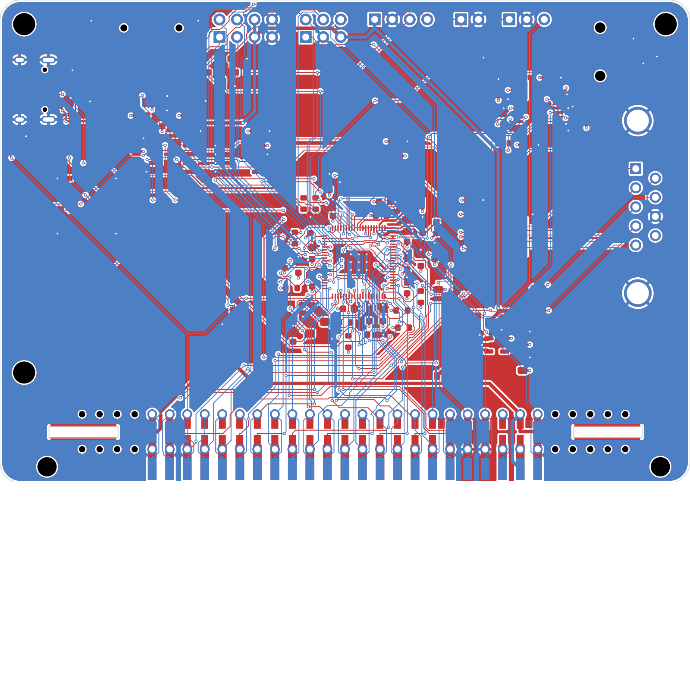
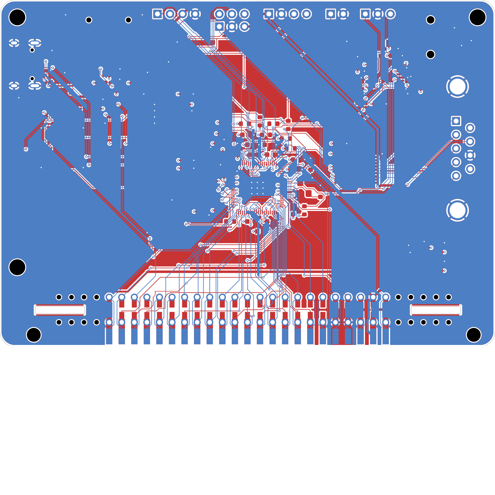

# OpenSpand SMD2

> The main design is now the [OpenSpand Card](../README.md), which is based on this
> board. SMD2 is kept for reference: it plugs straight onto the ZX81's edge connector.

A fork of the original OpenSpand SMD board, laid out for easier routing. (SMD kept
upstream's GPIO map and ran the stock firmware; it has been retired and is in the git
history.) The circuit and parts are the same. What changes is which RP2350B GPIO drives
which signal, how the chip is turned, and where a few parts sit. The cost is firmware
compatibility: SMD2 needs the patched pin map in [firmware/](firmware/) and doesn't run
the stock OpenSpand build.

**Status: unverified prototype (rev 0.1), fully routed.** ERC is clean. DRC shows no
unconnected items, clearance errors or shorts, and the PCB matches the schematic. No board
has been built, and the firmware patch hasn't been compiled or tested.

## What changed

**GPIO map.** The ZX81 edge socket's pins run, left to right: control lines, then the
address bus, then the data bus. The new map puts the RP2350B's GPIOs in that same order:

| GPIO | Signal | Notes |
| --- | --- | --- |
| 0–7 | RFSH, M1, RST, WR, RD, IORQ, MREQ, HALT | the socket's left-to-right order |
| 8–23 | A0–A15 | in order, read as `(gpio_in >> 8) & 0xFFFF` |
| 24–31 | D0–D7 | in order, read as `gpio_in >> 24` |
| 32 | Z80_CLK | in the video PIO's window (GPIO base 16) |
| 33–35 | I2S BCLK, WS, DOUT | |
| 36–37 | VIDEO_SYNC, VIDEO_DATA | |
| 38–39 | LED red, LED green | PWM slice 11 |
| 40–41 | UART1 TX, RX | |
| 42–43 | I2C1 SDA, SCL | |
| 44–47 | SPI1 MISO, CS, SCK, MOSI | microSD |

Side benefit: GPIO40–47 are the ADC pins, which aren't 5 V tolerant. Upstream put
A8–A15 there. Now every 5 V Z80 line is on a 5 V-tolerant pin, and the ADC pins carry
only 3.3 V signals.

**U2 turned 90° counter-clockwise.** GPIO0–31 now face the edge socket. GPIO32–47 face the
top-edge connectors they serve. The QSPI flash, USB and core regulator sit to the left of
the chip, on the USB-C side.

**Parts moved out of the bus path.**
- The LDO (U1), its diode (D1) and its capacitors moved to the bottom right, beside the
  socket's 5 V pin.
- The joystick 5 V jumpers moved toward the DE-9.
- The flash moved to the left of U2, with its decoupling caps above it.

**I2C expansion header removed.** J10 is now a 1×4 UART header (TX, RX, 5 V, GND). The
I2C bus still serves the on-board RTC, EEPROM and I/O expander.

## Result

Same rules as SMD: 0.127 mm tracks and gaps, 0.45/0.25 mm vias, 4 layers.

| | SMD | SMD2 |
| --- | --- | --- |
| Signal vias | 165 | 126 |
| Total track | 4167 mm | 3520 mm |
| Z80 bus track | 1628 mm | 1319 mm |
| Signals routed through a plane | QSPI_SS on In1 | none |
| Open after the autorouter | 6 | 1 |
| Hand-directed fixes | 4 | none |

The single connection Freerouting left open was closed by `finish.py` on its first
attempt, with no rip-up.

| SMD | SMD2 |
| --- | --- |
|  |  |

## Firmware

`firmware/smd2-pins.patch` applies to upstream OpenSpand_SW 0.51.0:

```bash
cd OpenSpand/OpenSpand_SW
patch -p1 < /path/to/smd2/firmware/smd2-pins.patch
```

It changes five files:
- **`pins.h`**: the new map above (also in [firmware/pins.h](firmware/pins.h)).
- **`HRT_impl.h`**: the data and address accessors gain one shift each. Control-line tests
  only change pin numbers, and they still come from one `gpio_in` read.
- **`pio_video_code_impl.h`**: calls `pio_set_gpio_base(pio0, 16)` before loading the
  video programs, so PIO0 can see Z80_CLK on GPIO32 and the video pins.
- **`pio_video_code.pio` / `pio_video_code_pio.h`**: the `wait gpio` index for Z80_CLK
  becomes 16 (GPIO32 relative to base 16). The header was edited by hand. Regenerate it
  with `pioasm` and compare.

Nothing else needs to change: SPI1, I2C1, UART1 and the LED PWM slice already follow the
pin numbers in `pins.h`.

Check these before trusting the patch:
- **Timing**: the Z80 handlers now do one extra shift per data or address read, about
  5 ns at 208 MHz. It should fit, but confirm on hardware.
- **I2S on GPIO33–35**: the arduino-pico I2S library has to load its PIO program with
  GPIO base 16. If it shares PIO0 with the video code, both must agree on that base.
- **SDK pin handling**: the SDK calls in the video setup are given absolute pin numbers
  above 31. Check that your pico-sdk / arduino-pico version handles them correctly with
  a GPIO base set.

## Regenerating

Same pipeline as the card ([how it works](../card/README.md#how-the-board-is-routed)), run
from this folder's `tools/`:

```bash
cd smd2/tools
python3 gen_sch.py
KPY=/Applications/KiCad/KiCad.app/Contents/Frameworks/Python.framework/Versions/Current/bin/python3
$KPY gen_pcb.py
FREEROUTING_JAR=~/freerouting.jar JAVA=/opt/homebrew/opt/openjdk/bin/java $KPY route.py 150
$KPY finish.py
python3 export_fab.py
```

`hardware/lib` is already built. Rerun `gen_lib.py` only if you change footprints.

## Ordering

Fab files are in `hardware/fab/`, named `OpenSpand-SMD2-*`. Ordering is as for the card in
the [main README](../README.md#ordering-from-jlcpcb), without the gold fingers. The L1,
jack-pinout and low-stock notes there apply here too, plus:

- **Hand-fit**: the ZX81 edge-connector socket (same part as upstream), the DE-9, and the
  optional SWD, external SPI, UART, digitized-audio and video headers.
- **DE-9 on the bottom**: the joystick connector is fitted on the bottom side at the right
  edge, and its shell sticks out about 7 mm past the edge.
- **Edge-socket footprint**: J1's GND pads sit 0.16 mm from its own board-edge slots
  (4 DRC warnings). This comes unchanged from the upstream footprint, which has been made.

## License

Hardware: CC BY-SA 4.0, as a derivative of OpenSpand HW 1.3.1 by Adam Klotblixt & ZX-Team.
The firmware patch modifies GPL-3.0 code from OpenSpand_SW and is GPL-3.0.
